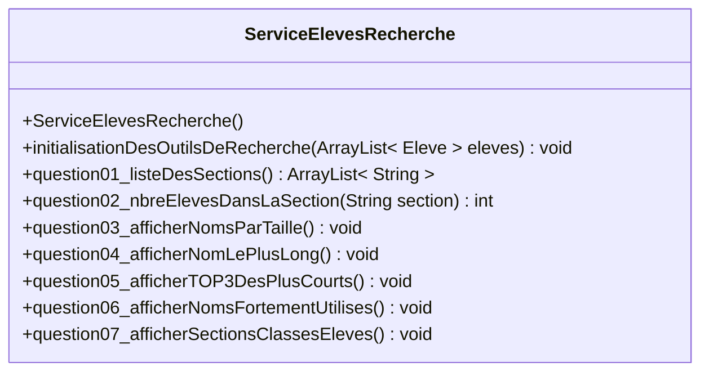

# Problèmes à résoudre

Si vous avez déjà lu et mis en place ce qui est décrit ci-dessous et que vous souhaitez directement vous rendre à une question spécifique ci-dessous :

[Question 1 - la liste des sections](#question-1---la-liste-des-sections)  
[Question 2 - la liste des sections ainsi que leur nombre d'élèves](#question-2---la-liste-des-sections-ainsi-que-leur-nombre-délèves)  
[Question 3 - la liste des noms+prénoms des élèves, du plus long au plus court](#question-3---la-liste-des-nomsprénoms-des-élèves-du-plus-long-au-plus-court)  
[Question 4 - Le(s) plus long(s) noms+prenoms parmi tous les élèves](#question-4---les-plus-longs-nomsprenoms-parmi-tous-les-élèves)  
[Question 5 - Le TOP 3 des noms+prenoms les plus courts parmi tous les élèves](#question-5---le-top-3-des-nomsprenoms-les-plus-courts-parmi-tous-les-élèves)  
[Question 6 - Les noms de famille utilisés par plus de 3 élèves (=prénoms différents)](#question-6---les-noms-de-famille-utilisés-par-plus-de-3-élèves-prénoms-différents)  
[Question 7 - Sections par section, classe pro par classe pro, produire la liste des élèves concernés](#question-7---sections-par-section-classe-pro-par-classe-pro-produire-la-liste-des-élèves-concernés)  

## Les classes nécessaires pour l'ensemble de ces exercices

Dans ces nombreux petits exercices ci-après, vous allez utiliser ces deux classes pour représenter les données et pour les obtenir :

- la classe `Eleve` déjà fournie
- le service `ServiceElevesListe` afin d'obtenir ces données

## Code pour l'application

Commencez par mettre le code fourni ci-dessous dans `demarrerExercicePartie3_LesEleves()` afin d'ensuite pouvoir tester votre travail sur votre service `ServiceElevesRecherche` :

```java
    public static void demarrerExercicePartie3_LesEleves() {

        System.out.println();
        System.out.println("===========================================");
        System.out.println("Exercice partie 3 - Exercices d'entraînement avec des élèves");
        System.out.println("===========================================");
        System.out.println();

        // Créer les instances des services avec des élèves
        ServiceElevesListe serviceElevesListe = new ServiceElevesListe();
        ServiceElevesRecherche serviceElevesRecherche = new ServiceElevesRecherche();

        // Charger les données et afficher les informations
        ArrayList<Eleve> eleves = serviceElevesListe.listeDeTousLesEleves();
        System.out.println("Il y a au total " + eleves.size() + " élèves qui ont été chargés et qu'il faut traiter.");

        // Indexation des données
        System.out.print("Indexation des données : ");
        serviceElevesRecherche.initialisationDesOutilsDeRecherche(eleves);
        System.out.println("terminée !");
        System.out.println();

        // Question N°1
        System.out.println("-------------------------------------------");
        ArrayList<String> sectionsExistantes = serviceElevesRecherche.question01_listeDesSections();
        System.out.println("Les sections existantes dans l'ordre sont : " + sectionsExistantes);
        System.out.println();

        // Question N°2
        System.out.println("-------------------------------------------");
        System.out.println("Les sections existantes avec le nombre d'élèves sont dans l'ordre :");
        for (String section : sectionsExistantes) {
            int nbreEleves = serviceElevesRecherche.question02_nbreElevesDansLaSection(section);
            System.out.println("La section [" + section + "] avec [" + nbreEleves + "] élèves.");
        }
        System.out.println();

        // Question N°3
        serviceElevesRecherche.question03_afficherNomsParTaille();

        // Question N°4
        serviceElevesRecherche.question04_afficherNomLePlusLong();

        // Question N°5
        serviceElevesRecherche.question05_afficherTOP3DesPlusCourts();

        // Question N°6
        serviceElevesRecherche.question06_afficherNomsFortementUtilises();

        // Question N°7
        serviceElevesRecherche.question07_afficherSectionsClassesEleves();
    }
```

## Exercices / Travail à réaliser

Question par question ci-dessous, vous allez progressivement implémenter ces méthodes du service `ServiceElevesRecherche` afin de le doter des fonctionnalités requises.

Commencez par créer ce service avec l'infrastructure suivante :



Pour le moment, à ce stade du projet afin que le projet puisse compiler, faites en sorte que vos méthodes `question01_listeDesSections()` et `question02_nbreElevesDansLaSection()` retournent une liste vide et un zéro.

### Question 1 - la liste des sections

À l'aide de l'ensemble des élèves qui vous est fournie par le service `ServiceElevesListe` et transmise par l'application à la méthode `initialisationDesOutilsDeRecherche()`, faites le nécessaire afin de pouvoir identifier **la liste des sections qui existent, sans doublons et alphabétiquement triée**.

La signature de la méthode qui répondra à cette question dans votre service `ServiceElevesRecherche` devra être :

```java
    /**
     * Produit la liste sans doublons et alphabétiquement triée de toutes les
     * sections existantes parmi les élèves.
     * 
     * @return la liste comme précité
     */
    public ArrayList<String> question01_listeDesSections() {}
```

Codez cette fonctionnalité et rajoutez ensuite le code nécessaire dans votre `Application` afin de vérifier son bon fonctionnement.

Vous devriez obtenir ceci sur la console :

```text
===========================================
Exercice partie 3 - Exercices d'entraînement avec des élèves
===========================================

Il y a au total 445 élèves qui ont été chargés et qu'il faut traiter.
Indexation des données : terminée !

-------------------------------------------
Les sections existantes dans l'ordre sont : [Automaticiens, Electroniciens, Informaticiens, Maturité post-CFC, Polymécaniciens]
```

### Question 2 - la liste des sections ainsi que leur nombre d'élèves

Faites le nécessaire afin de pouvoir rapidement connaître **le nombre d'élèves présents dans une section**. À l'aide de la fonctionnalité précédente (question N°1) on pourra facilement produire la liste des sections qui existent, sans doublons et alphabétiquement triée avec le nombre d'élèves contenus.

La signature de la méthode qui répondra à cette question dans votre service `ServiceElevesRecherche` devra être :

```java
    /**
     * Retourne le nombre d'élèves présents dans la section fournie (insensible à la casse).
     * 
     * @param section la section à utiliser (insensible à la casse) pour cette recherche
     * 
     * @return le nombre précité
     */
    public int question02_nbreElevesDansLaSection(String section) {}
```

Codez cette fonctionnalité et rajoutez ensuite le code nécessaire dans votre `Application` afin de vérifier son bon fonctionnement.

Vous devriez obtenir ceci sur la console :

```text
-------------------------------------------
Les sections existantes avec le nombre d'élèves sont dans l'ordre :
La section [Automaticiens] avec [72] élèves.
La section [Electroniciens] avec [67] élèves.
La section [Informaticiens] avec [145] élèves.
La section [Maturité post-CFC] avec [111] élèves.
La section [Polymécaniciens] avec [50] élèves.
```

### Question 3 - la liste des noms+prénoms des élèves, du plus long au plus court

Trouvez une solution afin de répondre à cette question de manière efficace.

Vous devriez obtenir ceci sur la console :

```text
----------------------------------
Avec longueur [36] : [Van Wynsberghe Arnaud Clément Julien]
Avec longueur [35] : [Fortunato Portela Ricardo Alexandre]
Avec longueur [33] : [Soares Rodrigues Juliana Cristina]
Avec longueur [31] : [Ramos Da Silva Michaël Henrique]
Avec longueur [30] : [Da Silva Ferreira Patrick Joel, Santos Ramos Ricardo Alexandre]
Avec longueur [29] : [Almeida Valente Bruno Gabriel, Canhoto Madeira Valter Daniel, Santos Sousa Roberto Emmanuel]
Avec longueur [27] : [Martins Leitao Ivan Claudio]
Avec longueur [26] : [Albuquerque Ferreira Danny, Burin des Roziers Donatien, Gomes Pinheiro John Carlos, Venegas Contreras Gamaniel]
Avec longueur [25] : [Formanowski Alexander Jan, Pereira de Barros Orlando]
Avec longueur [24] : [De Almeida Silva Adriano, Deschenaux Charles-Henri, Ribeiro Ventura Jonathan, Riquelme Adilson Esteban, Rodrigues Morgado Micael, Sabatino Fabio-Salvatore, Weissbrodt Jean-Philippe]
Avec longueur [23] : [Garcia Barros Alejandro, Serdoura Goncalves Hugo, Soares Da Silva Sidoine]
Avec longueur [22] : [Domingues Alves Micaël, Kessler Philip Patrick, Lo Nigro Valerio Mario, Marcelino de Matos Gil]
Avec longueur [21] : [Amirthalingam Anoryan, Correia Pinto Ricardo, De Paiva Pinto Marcio, Kondratowicz Ladislas]
Avec longueur [20] : [Aebischer Christophe, Baumgartner Dan Yvan, Brüllhardt Sébastien, Conde Gonçalves Joel, Delacrétaz Sébastien, Farine Jean-Baptiste, Garcia Barros Daniel, Grilo Carvalho David, Lopes Braga Natanael, Piller-Hoffer Jérémy, Pinto Vieira Mickael, Ruffini Andrea Marco, Summerfield Jonathan, Weissbaum Christophe, Zeidguy Nassim Walid]
Avec longueur [19] : [Blanquet Christophe, Cetinjanin Tomislav, Demierre Christophe, Dessonnaz Alexandre, Eltschinger Bastien, Grossenbacher Ralph, Hamdi Mohamed Amine, Hildebrand Baptiste, Kyburz Timo Dimitri, Zaroual Yassin Mike]
Avec longueur [18] : [Albertini Floriano, Bajraktaraj Dardan, Bonneville Quentin, Geneviève Geoffrey, Hillringhaus Lucas, Lanthemann Nicolas, Margueron Benjamin, Perritaz Alexandre, Pillonel Sébastien, Radermecker Pierre, Schaefer Sébastien, Schaller Sebastian, Silacci Alessandro, Terrapon Théophile]
Avec longueur [17] : [Alborghetti Lucas, Ballaman Benjamin, Bouquet Sébastien, Compagnon Dimitri, Dujardin François, Heckel Christophe, Jendly Christophe, Longchamp Yannick, Marclay Alexandre, Monterroso Adrien, Nunes Pinto Ranon, Poinçot Dominique, Rossier Sébastien, Salvisberg Gérald, Schenker Frédéric, Schluchin Anthony, Schneuwly Andreas, Wohlhauser Cyrill, Zwahlen Christian]
Avec longueur [16] : [Antunez Leonardo, Audriaz Stéphane, Baechler Nicolas, Baeriswyl Gaétan, Berthoud Tristan, Blanchard Fabian, Bongard Jonathan, Borgstedt Maxime, Bovigny Nathalie, Burkhard Florian, Charrière Maxime, Cherbuin Anthony, Christe Matthias, Clément Caroline, Cressier Estelle, Delaquis Quentin, Delhaye Corentin, Dousse Alexandre, Droux Clémentine, Dujardin Thibaut, Eigenmann Elodie, Gaillard Nicolas, Grandjean Didier, Guisolan Sylvain, Gurtner Valentin, Hervieux Yannick, Jourdan Matthieu, Journet Thibault, Kaeser Dominique, Kelmendi Shpetim, Kinder Sebastian, Macherel Nicolas, Maillard Thibaut, Michel Guillaume, Munkiba Joliesse, Nguyen Dang Khoa, Nidegger Vincent, Overney Baptiste, Reynaud Frédéric, Schornoz William, Schröder Yannick, Schwartz Raphaël, Studemann Julien, Sugnaux Bénédict, Surchat Jonathan, Ursenbacher Tyll, Varenne Baptiste, Wiegandt Anthony]
Avec longueur [15] : [Aebischer Lenny, Alansar Raphaël, Anstett Thierry, Baechler Gaëlle, Bossart Emanuel, Bossy Guillaume, Brodard Florian, Bulliard Steven, Bulliard Xavier, Carrascosa Yoan, Castella Thomas, Charrière Vital, Ciampone Adrien, Decrind Charles, Ferrari Massimo, Fontaine Arnaud, Fragniere Jonas, Gachoud Vincent, Gagnaux Mathias, Gaillard Maxime, Gaillard Pierre, Grandjean Kevin, Gremaud Yannick, Gremion Mathieu, Guillet Gabriel, Guisolan Benoît, Hertling Arnaud, Hustache Adrien, Islamoski Samet, Javet Sébastien, Jordan Valentin, Kieu Nguyen Bao, Konrad Johannes, Manzone Mickaël, Mauricio Fabian, Morattel Damien, Neuhaus Vincent, Nicolet Vincent, Nicollerat Loïc, Perritaz Joëlle, Piccand Antoine, Pivetta Nicolas, Portelli Jérémy, Presset Ludovic, Péclat Jonathan, Reynaud Mickael, Roubaty Fabrice, Schaller Thomas, Stadler Michael, Stauffer Damien, Sulejmani Fitim, Ulukütük Serkam, Vallat Matthieu, Wisler François]
Avec longueur [14] : [Ansermet Simon, Azemi Hajrulla, Barras Antoine, Berger Vincent, Bergmann Cyril, Bersier Julien, Beuret Killian, Blanchard Alan, Bouhanek Ramzi, Bovigny Pierre, Brügger Jérémy, Casareale Axel, Chassot Justin, Chassot Romain, Chaubert Louis, Clément Martin, Dagon Valentin, Dedelley Nolan, Denervaud Marc, Descombes Greg, Di Donato Gina, Di Via Nicolas, Ducrey Grégory, Dumas Stéphane, Esseiva Julien, Frehner Samuel, Gabriel Michel, Gachoud Emilie, Genoud Valérie, Gilliéron Loïc, Gremaud Joseph, Gremaud Romain, Greppi William, Grünig Jeffrey, Guerry Anthony, Guisolan Alain, Gumy Alexandre, Guélat Quentin, Hampaï Clément, Helfer Florian, Huber Benjamin, Jaquet Fabrice, Jolliet Charly, Jungo Benjamin, Lambert Maxime, Lauper Michaël, Lehmann Julian, Lizzola Nathan, Longchamp Yann, Mauron Jocelyn, Mauron Nicolas, Meuwly Jérémie, Miche Philippe, Michel Quentin, Monney Bastien, Ouederni Leila, Overney Adrien, Pasquier Colin, Pauchard Lucas, Perler Vincent, Perrottet Luke, Pillet Sylvain, Pillonel Simon, Pirlet Quentin, Pittet Nicolas, Pittet Raphaël, Pythoud Kilian, Romanens Karim, Roulin Jérémie, Rüeger Quentin, Rüeger Tristan, Sapin Floriane, Schaller Alain, Seydoux Maxime, Stettler Kevin, Stoeckli Jonas, Stricker Fabio, Stüssi Florent, Tornare Xavier, Uldry Marjorie, Vaucher Romain, Veluzat Martin, Waeber Quentin, Wenger Olivier, Zysset Maurice]
Avec longueur [13] : [Abdalla Danny, Abel Gauthier, Amantini Loïc, Andrey Stefan, Angeloz Jolan, Berger Adrien, Bordas Yannis, Butty Antoine, Bürgy Olivier, Cabras Manuel, Collaud Cyril, Cotting Timon, Curty Olivier, Darbon Adrian, Dufresne Loïc, Dux Guillaume, Ecoffey Sarah, Equey Jérémie, Fasel Olivier, Favre Gregory, Feyer Nicolas, Fiore Camillo, Girard Gaëlle, Gremaud Simon, Hayoz Michael, Hemmer Lucien, Hohl Jonathan, Horner Maxime, Huber Nicolas, Izairi Mensur, Januth Laurin, Jaquet Landry, Jaquier Lucas, Jelinski Nils, Magne Gabriel, Maillard Jean, Manixab Kevin, Marion Thomas, Maritz Samuel, Mettraux Axel, Meuwly Maxime, Müller Cédric, Müller Thomas, Nguyen Damien, Nicole Benoît, Ouertani Sami, Raboud Martin, Rappo Claudio, Repond Benoît, Rial Jonathan, Riedener Yves, Riedo Raffael, Rolle Antoine, Sallin Maxime, Saugy Florent, Savary Gilles, Schafer Simon, Schmid Jérémy, Schmid Roland, Schorro David, Spat Philippe, Stern Léonard, Terrapon Eric, Torche Pamela, Torche Samuel, Tschopp Bruno, Waeber Gilles, Wenger Roland, Willemin Hugo, Würgler Laure, Zamofing Rémi]
Avec longueur [12] : [Ahmetaj Agon, Andrey Lucas, Anstett Eric, Balmer Bruno, Baula Adrien, Blanc Jérémy, Boscoe Leila, Bruchez Gary, Brügger Luca, Buchs Jérémy, Caesar Janko, Chagra Ahmed, Cherix Robin, Dumas Ayrton, Firat Cemali, Jevtic Dimso, Kabeya Zélia, Lorenz Sonny, Losey Jérôme, Mattei Marco, Mazari Mehdi, Monney César, Monney Simon, Müller Dylan, Oertle Jimmy, Orsini Lucas, Overney Paul, Ozturk Velat, Pache Marius, Peiry Adrien, Peisl Adrien, Raemy Samuel, Rahm Abraham, Remy Raphael, Rolle Jérémy, Rosset Denis, Roubaty Marc, Sadiku Veton, Sahli Benoît, Sallin Lucas, Savic Dragan, Schwab Micha, Scinto Julia, Stoll Sandro, Stucki Alain, Tinguely Léa, Vial Adeline, Wyssa Pascal, Zayani Karim]
Avec longueur [11] : [Alt Thibaud, Badoud Remi, Berset Jean, Bullot Loïc, Buob Lionel, Burgy Steve, Bürgy Louis, Cerini Timo, Cottet Dany, Davet Josua, Djoric Ivan, Doudin Yann, Ebibi Sabit, Egger Jonas, Francey Luc, Garana Fadi, Julmy Steve, Juvet Robin, Monney Rémy, Murith Loïc, Osman Salah, Pilet Lucas, Puthod Loic, Repond Jean, Savioz Loïc, Sezen Semra, Sudan Hervé]
Avec longueur [10] : [Bart Serge, Bosson Léo, Clerc Joël, Dubey Eric, Fasel Yves, Folly Loïc, Gay Jordan, Jacob Loïc, Kopp Kevin, Mayr Cyril, Owen Scott, Sauty Axel, Senn Joana, Sueur Alan, Tietz Alan, Zahno Yann]
Avec longueur [9] : [Butty Joé, Huber Jan]
Avec longueur [8] : [Rio Luca]
```

### Question 4 - Le(s) plus long(s) noms+prenoms parmi tous les élèves

Trouvez une solution afin de répondre à cette question de manière efficace.

Vous devriez obtenir ceci sur la console :

```text
----------------------------------
Les noms les plus longs ont 36 caractères et sont :
 - Van Wynsberghe Arnaud Clément Julien
```

### Question 5 - Le TOP 3 des noms+prenoms les plus courts parmi tous les élèves

Trouvez une solution afin de répondre à cette question de manière efficace.

Vous devriez obtenir ceci sur la console avec un TOP 3:

```text
----------------------------------
Le TOP [3] des noms les plus courts sont :
Avec longueur [8] : [Rio Luca]
Avec longueur [9] : [Butty Joé, Huber Jan]
Avec longueur [10] : [Bart Serge, Bosson Léo, Clerc Joël, Dubey Eric, Fasel Yves, Folly Loïc, Gay Jordan, Jacob Loïc, Kopp Kevin, Mayr Cyril, Owen Scott, Sauty Axel, Senn Joana, Sueur Alan, Tietz Alan, Zahno Yann]
```

et ceci avec un TOP 5:

```text
----------------------------------
Le TOP [5] des noms les plus courts sont :
Avec longueur [8] : [Rio Luca]
Avec longueur [9] : [Butty Joé, Huber Jan]
Avec longueur [10] : [Bart Serge, Bosson Léo, Clerc Joël, Dubey Eric, Fasel Yves, Folly Loïc, Gay Jordan, Jacob Loïc, Kopp Kevin, Mayr Cyril, Owen Scott, Sauty Axel, Senn Joana, Sueur Alan, Tietz Alan, Zahno Yann]
Avec longueur [11] : [Alt Thibaud, Badoud Remi, Berset Jean, Bullot Loïc, Buob Lionel, Burgy Steve, Bürgy Louis, Cerini Timo, Cottet Dany, Davet Josua, Djoric Ivan, Doudin Yann, Ebibi Sabit, Egger Jonas, Francey Luc, Garana Fadi, Julmy Steve, Juvet Robin, Monney Rémy, Murith Loïc, Osman Salah, Pilet Lucas, Puthod Loic, Repond Jean, Savioz Loïc, Sezen Semra, Sudan Hervé]
Avec longueur [12] : [Ahmetaj Agon, Andrey Lucas, Anstett Eric, Balmer Bruno, Baula Adrien, Blanc Jérémy, Boscoe Leila, Bruchez Gary, Brügger Luca, Buchs Jérémy, Caesar Janko, Chagra Ahmed, Cherix Robin, Dumas Ayrton, Firat Cemali, Jevtic Dimso, Kabeya Zélia, Lorenz Sonny, Losey Jérôme, Mattei Marco, Mazari Mehdi, Monney César, Monney Simon, Müller Dylan, Oertle Jimmy, Orsini Lucas, Overney Paul, Ozturk Velat, Pache Marius, Peiry Adrien, Peisl Adrien, Raemy Samuel, Rahm Abraham, Remy Raphael, Rolle Jérémy, Rosset Denis, Roubaty Marc, Sadiku Veton, Sahli Benoît, Sallin Lucas, Savic Dragan, Schwab Micha, Scinto Julia, Stoll Sandro, Stucki Alain, Tinguely Léa, Vial Adeline, Wyssa Pascal, Zayani Karim]
```

### Question 6 - Les noms de famille utilisés par plus de 3 élèves (=prénoms différents)

Trouvez une solution afin de répondre à cette question de manière efficace.

Vous devriez obtenir ceci sur la console :

```text
----------------------------------
Les élèves dont le nom de famille est utilisé plus de 3x sont :
 - [Gremaud][Joseph]
 - [Gremaud][Romain]
 - [Gremaud][Simon]
 - [Gremaud][Yannick]
 - [Monney][Bastien]
 - [Monney][César]
 - [Monney][Rémy]
 - [Monney][Simon]
```

### Question 7 - Sections par section, classe pro par classe pro, produire la liste des élèves concernés

Trouvez une solution afin de répondre à cette question de manière efficace.

Vous devriez obtenir ceci sur la console :

```text
----------------------------------
Voici la liste des sections, leurs classes pro et leurs élèves :
Section des [Automaticiens]
  => Contenu de la classe PRO [1A]
    + [Amirthalingam Anoryan]
    + [Andrey Lucas]
    + [Dedelley Nolan]
    + [Delaquis Quentin]
    + [Eigenmann Elodie]
    + [Ferrari Massimo]
    + [Hemmer Lucien]
    + [Hertling Arnaud]
    + [Mauron Nicolas]
    + [Mettraux Axel]
    + [Oertle Jimmy]
    + [Orsini Lucas]
    + [Ouertani Sami]
    + [Pittet Raphaël]
    + [Reynaud Mickael]
    + [Riedo Raffael]
    + [Rio Luca]
    + [Riquelme Adilson Esteban]
    + [Tietz Alan]
    + [Vaucher Romain]

  => Contenu de la classe PRO [2A]
    + [Audriaz Stéphane]
    + [Bart Serge]
    + [Baumgartner Dan Yvan]
    + [Berger Vincent]
    + [Bergmann Cyril]
    + [Butty Antoine]
    + [Bürgy Louis]
    + [Darbon Adrian]
    + [Heckel Christophe]
    + [Horner Maxime]
    + [Huber Jan]
    + [Januth Laurin]
    + [Lehmann Julian]
    + [Piccand Antoine]
    + [Pittet Nicolas]
    + [Sahli Benoît]
    + [Stricker Fabio]
    + [Stüssi Florent]
    + [Weissbaum Christophe]
    + [Zahno Yann]

  => Contenu de la classe PRO [3A]
    + [Berset Jean]
    + [Berthoud Tristan]
    + [Blanc Jérémy]
    + [Bossy Guillaume]
    + [Fontaine Arnaud]
    + [Formanowski Alexander Jan]
    + [Guélat Quentin]
    + [Michel Quentin]
    + [Monney Simon]
    + [Murith Loïc]
    + [Pilet Lucas]
    + [Pillonel Sébastien]
    + [Raemy Samuel]
    + [Savic Dragan]
    + [Schafer Simon]
    + [Schornoz William]
    + [Studemann Julien]
    + [Tschopp Bruno]
    + [Wenger Roland]

  => Contenu de la classe PRO [4A]
    + [Castella Thomas]
    + [Eltschinger Bastien]
    + [Fiore Camillo]
    + [Gaillard Maxime]
    + [Gremion Mathieu]
    + [Jaquet Fabrice]
    + [Jaquier Lucas]
    + [Margueron Benjamin]
    + [Peiry Adrien]
    + [Rüeger Quentin]
    + [Schaefer Sébastien]
    + [Serdoura Goncalves Hugo]
    + [Terrapon Théophile]


Section des [Electroniciens]
  => Contenu de la classe PRO [1E]
    + [Abel Gauthier]
    + [Ballaman Benjamin]
    + [Borgstedt Maxime]
    + [Brügger Luca]
    + [Buob Lionel]
    + [Carrascosa Yoan]
    + [Collaud Cyril]
    + [Di Donato Gina]
    + [Gremaud Yannick]
    + [Grilo Carvalho David]
    + [Javet Sébastien]
    + [Jelinski Nils]
    + [Kieu Nguyen Bao]
    + [Lo Nigro Valerio Mario]
    + [Marion Thomas]
    + [Mazari Mehdi]
    + [Osman Salah]
    + [Ozturk Velat]
    + [Pereira de Barros Orlando]
    + [Radermecker Pierre]
    + [Repond Jean]
    + [Sabatino Fabio-Salvatore]

  => Contenu de la classe PRO [2E]
    + [Abdalla Danny]
    + [Antunez Leonardo]
    + [Azemi Hajrulla]
    + [Bajraktaraj Dardan]
    + [Bordas Yannis]
    + [Chassot Justin]
    + [Compagnon Dimitri]
    + [Fasel Olivier]
    + [Guisolan Sylvain]
    + [Hervieux Yannick]
    + [Jungo Benjamin]
    + [Pivetta Nicolas]
    + [Presset Ludovic]
    + [Roubaty Fabrice]
    + [Stauffer Damien]
    + [Stucki Alain]
    + [Terrapon Eric]
    + [Wiegandt Anthony]
    + [Willemin Hugo]

  => Contenu de la classe PRO [3E]
    + [Buchs Jérémy]
    + [Bullot Loïc]
    + [Bürgy Olivier]
    + [Charrière Maxime]
    + [Clerc Joël]
    + [Clément Caroline]
    + [Girard Gaëlle]
    + [Hildebrand Baptiste]
    + [Meuwly Jérémie]
    + [Nguyen Damien]
    + [Nidegger Vincent]
    + [Poinçot Dominique]
    + [Raboud Martin]
    + [Schenker Frédéric]
    + [Schneuwly Andreas]
    + [Tornare Xavier]

  => Contenu de la classe PRO [4E]
    + [Bongard Jonathan]
    + [Monney Rémy]
    + [Rolle Antoine]
    + [Schluchin Anthony]
    + [Scinto Julia]
    + [Sezen Semra]
    + [Soares Rodrigues Juliana Cristina]
    + [Stern Léonard]
    + [Tinguely Léa]
    + [Torche Pamela]


Section des [Informaticiens]
  => Contenu de la classe PRO [1I1]
    + [Journet Thibault]
    + [Savioz Loïc]

  => Contenu de la classe PRO [1I2]
    + [Marclay Alexandre]

  => Contenu de la classe PRO [1i1]
    + [Almeida Valente Bruno Gabriel]
    + [Baechler Gaëlle]
    + [Bosson Léo]
    + [Cherbuin Anthony]
    + [Conde Gonçalves Joel]
    + [Dumas Ayrton]
    + [Feyer Nicolas]
    + [Guerry Anthony]
    + [Kondratowicz Ladislas]
    + [Lanthemann Nicolas]
    + [Longchamp Yannick]
    + [Marcelino de Matos Gil]
    + [Mattei Marco]
    + [Pasquier Colin]
    + [Rosset Denis]
    + [Van Wynsberghe Arnaud Clément Julien]
    + [Waeber Gilles]
    + [Würgler Laure]
    + [Zamofing Rémi]

  => Contenu de la classe PRO [1i2]
    + [Amantini Loïc]
    + [Bovigny Pierre]
    + [Burin des Roziers Donatien]
    + [Correia Pinto Ricardo]
    + [Dubey Eric]
    + [Gay Jordan]
    + [Gremaud Joseph]
    + [Hamdi Mohamed Amine]
    + [Kopp Kevin]
    + [Manixab Kevin]
    + [Martins Leitao Ivan Claudio]
    + [Mauron Jocelyn]
    + [Müller Dylan]
    + [Pauchard Lucas]
    + [Pinto Vieira Mickael]
    + [Sauty Axel]
    + [Schwartz Raphaël]
    + [Soares Da Silva Sidoine]
    + [Torche Samuel]

  => Contenu de la classe PRO [2I1]
    + [Alansar Raphaël]
    + [Alborghetti Lucas]
    + [Angeloz Jolan]
    + [Barras Antoine]
    + [Bouquet Sébastien]
    + [Cabras Manuel]
    + [Cottet Dany]
    + [De Almeida Silva Adriano]
    + [Droux Clémentine]
    + [Ecoffey Sarah]
    + [Firat Cemali]
    + [Hillringhaus Lucas]
    + [Hustache Adrien]
    + [Kinder Sebastian]
    + [Miche Philippe]
    + [Perrottet Luke]
    + [Portelli Jérémy]
    + [Rial Jonathan]
    + [Romanens Karim]
    + [Vallat Matthieu]

  => Contenu de la classe PRO [2I2]
    + [Albuquerque Ferreira Danny]
    + [Blanchard Alan]
    + [Butty Joé]
    + [Chassot Romain]
    + [Dessonnaz Alexandre]
    + [Fasel Yves]
    + [Fortunato Portela Ricardo Alexandre]
    + [Gabriel Michel]
    + [Mauricio Fabian]
    + [Monney César]
    + [Morattel Damien]
    + [Peisl Adrien]
    + [Péclat Jonathan]
    + [Ramos Da Silva Michaël Henrique]
    + [Sallin Lucas]
    + [Spat Philippe]
    + [Surchat Jonathan]
    + [Zayani Karim]

  => Contenu de la classe PRO [3I1]
    + [Aebischer Lenny]
    + [Bersier Julien]
    + [Bovigny Nathalie]
    + [Canhoto Madeira Valter Daniel]
    + [Casareale Axel]
    + [Chaubert Louis]
    + [Delhaye Corentin]
    + [Denervaud Marc]
    + [Djoric Ivan]
    + [Doudin Yann]
    + [Folly Loïc]
    + [Fragniere Jonas]
    + [Grandjean Kevin]
    + [Helfer Florian]
    + [Lambert Maxime]
    + [Lopes Braga Natanael]
    + [Monterroso Adrien]
    + [Pirlet Quentin]
    + [Pythoud Kilian]
    + [Schaller Alain]
    + [Silacci Alessandro]

  => Contenu de la classe PRO [3I2]
    + [Albertini Floriano]
    + [Alt Thibaud]
    + [Bouhanek Ramzi]
    + [Brodard Florian]
    + [Bruchez Gary]
    + [Cherix Robin]
    + [Domingues Alves Micaël]
    + [Esseiva Julien]
    + [Gomes Pinheiro John Carlos]
    + [Greppi William]
    + [Jourdan Matthieu]
    + [Magne Gabriel]
    + [Monney Bastien]
    + [Pillet Sylvain]
    + [Rappo Claudio]
    + [Riedener Yves]
    + [Schaller Thomas]
    + [Schmid Roland]
    + [Sueur Alan]
    + [Zaroual Yassin Mike]

  => Contenu de la classe PRO [4I1]
    + [Balmer Bruno]
    + [Christe Matthias]
    + [Dufresne Loïc]
    + [Farine Jean-Baptiste]
    + [Gachoud Emilie]
    + [Gremaud Simon]
    + [Guisolan Benoît]
    + [Hampaï Clément]
    + [Izairi Mensur]
    + [Longchamp Yann]
    + [Michel Guillaume]
    + [Ouederni Leila]
    + [Perritaz Joëlle]
    + [Sallin Maxime]
    + [Savary Gilles]

  => Contenu de la classe PRO [4I2]
    + [Badoud Remi]
    + [Blanquet Christophe]
    + [Ciampone Adrien]
    + [Dousse Alexandre]
    + [Egger Jonas]
    + [Francey Luc]
    + [Gaillard Pierre]
    + [Nicollerat Loïc]
    + [Roulin Jérémie]
    + [Ruffini Andrea Marco]


Section des [Maturité post-CFC]
  => Contenu de la classe PRO []
    + [Andrey Stefan]
    + [Ansermet Simon]
    + [Anstett Eric]
    + [Anstett Thierry]
    + [Baechler Nicolas]
    + [Baula Adrien]
    + [Berger Adrien]
    + [Blanchard Fabian]
    + [Bonneville Quentin]
    + [Boscoe Leila]
    + [Bossart Emanuel]
    + [Brügger Jérémy]
    + [Bulliard Xavier]
    + [Burgy Steve]
    + [Burkhard Florian]
    + [Caesar Janko]
    + [Cerini Timo]
    + [Cetinjanin Tomislav]
    + [Charrière Vital]
    + [Cotting Timon]
    + [Cressier Estelle]
    + [Curty Olivier]
    + [Da Silva Ferreira Patrick Joel]
    + [Dagon Valentin]
    + [Davet Josua]
    + [De Paiva Pinto Marcio]
    + [Delacrétaz Sébastien]
    + [Deschenaux Charles-Henri]
    + [Descombes Greg]
    + [Ducrey Grégory]
    + [Dumas Stéphane]
    + [Dux Guillaume]
    + [Ebibi Sabit]
    + [Equey Jérémie]
    + [Favre Gregory]
    + [Gachoud Vincent]
    + [Gagnaux Mathias]
    + [Gaillard Nicolas]
    + [Garana Fadi]
    + [Garcia Barros Alejandro]
    + [Garcia Barros Daniel]
    + [Geneviève Geoffrey]
    + [Genoud Valérie]
    + [Gilliéron Loïc]
    + [Grandjean Didier]
    + [Grossenbacher Ralph]
    + [Grünig Jeffrey]
    + [Guisolan Alain]
    + [Gurtner Valentin]
    + [Hayoz Michael]
    + [Hohl Jonathan]
    + [Huber Benjamin]
    + [Huber Nicolas]
    + [Islamoski Samet]
    + [Jacob Loïc]
    + [Jevtic Dimso]
    + [Jolliet Charly]
    + [Julmy Steve]
    + [Kabeya Zélia]
    + [Kaeser Dominique]
    + [Kelmendi Shpetim]
    + [Kessler Philip Patrick]
    + [Kyburz Timo Dimitri]
    + [Lauper Michaël]
    + [Lizzola Nathan]
    + [Lorenz Sonny]
    + [Losey Jérôme]
    + [Macherel Nicolas]
    + [Manzone Mickaël]
    + [Mayr Cyril]
    + [Munkiba Joliesse]
    + [Müller Cédric]
    + [Neuhaus Vincent]
    + [Nicole Benoît]
    + [Nicolet Vincent]
    + [Owen Scott]
    + [Pache Marius]
    + [Perler Vincent]
    + [Piller-Hoffer Jérémy]
    + [Pillonel Simon]
    + [Rahm Abraham]
    + [Remy Raphael]
    + [Repond Benoît]
    + [Reynaud Frédéric]
    + [Ribeiro Ventura Jonathan]
    + [Rodrigues Morgado Micael]
    + [Sadiku Veton]
    + [Sapin Floriane]
    + [Schaller Sebastian]
    + [Schmid Jérémy]
    + [Schorro David]
    + [Schwab Micha]
    + [Senn Joana]
    + [Seydoux Maxime]
    + [Stadler Michael]
    + [Stettler Kevin]
    + [Stoll Sandro]
    + [Sudan Hervé]
    + [Sugnaux Bénédict]
    + [Summerfield Jonathan]
    + [Uldry Marjorie]
    + [Ulukütük Serkam]
    + [Venegas Contreras Gamaniel]
    + [Vial Adeline]
    + [Waeber Quentin]
    + [Weissbrodt Jean-Philippe]
    + [Wenger Olivier]
    + [Wohlhauser Cyrill]
    + [Wyssa Pascal]
    + [Zwahlen Christian]
    + [Zysset Maurice]


Section des [Polymécaniciens]
  => Contenu de la classe PRO [1P]
    + [Brüllhardt Sébastien]
    + [Bulliard Steven]
    + [Chagra Ahmed]
    + [Clément Martin]
    + [Frehner Samuel]
    + [Gremaud Romain]
    + [Maritz Samuel]
    + [Rossier Sébastien]
    + [Santos Ramos Ricardo Alexandre]
    + [Saugy Florent]
    + [Schröder Yannick]
    + [Ursenbacher Tyll]
    + [Veluzat Martin]
    + [Wisler François]

  => Contenu de la classe PRO [2P]
    + [Beuret Killian]
    + [Di Via Nicolas]
    + [Gumy Alexandre]
    + [Jaquet Landry]
    + [Konrad Johannes]
    + [Nguyen Dang Khoa]
    + [Overney Paul]
    + [Puthod Loic]
    + [Rolle Jérémy]
    + [Roubaty Marc]
    + [Rüeger Tristan]
    + [Stoeckli Jonas]
    + [Varenne Baptiste]
    + [Zeidguy Nassim Walid]

  => Contenu de la classe PRO [3P]
    + [Demierre Christophe]
    + [Dujardin François]
    + [Dujardin Thibaut]
    + [Jordan Valentin]
    + [Maillard Thibaut]
    + [Meuwly Maxime]
    + [Müller Thomas]
    + [Overney Adrien]
    + [Overney Baptiste]
    + [Santos Sousa Roberto Emmanuel]

  => Contenu de la classe PRO [4P]
    + [Aebischer Christophe]
    + [Ahmetaj Agon]
    + [Baeriswyl Gaétan]
    + [Decrind Charles]
    + [Guillet Gabriel]
    + [Jendly Christophe]
    + [Juvet Robin]
    + [Maillard Jean]
    + [Nunes Pinto Ranon]
    + [Perritaz Alexandre]
    + [Salvisberg Gérald]
    + [Sulejmani Fitim]
```
